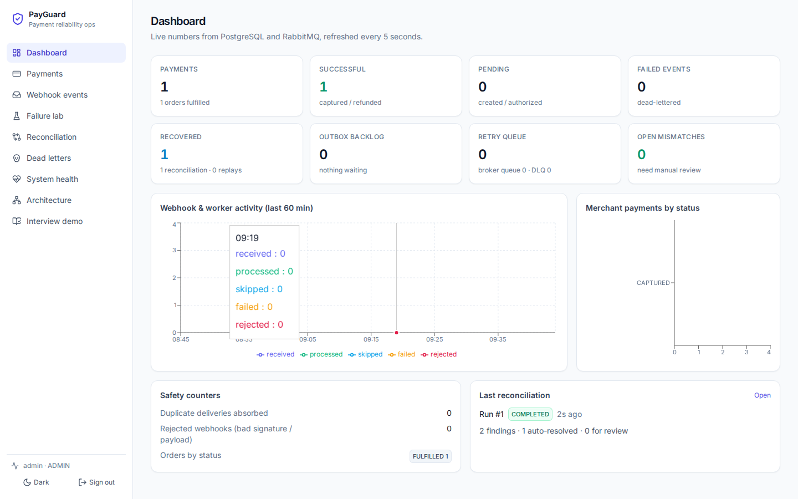
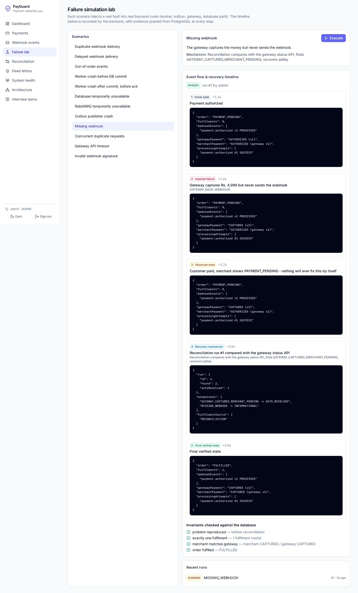
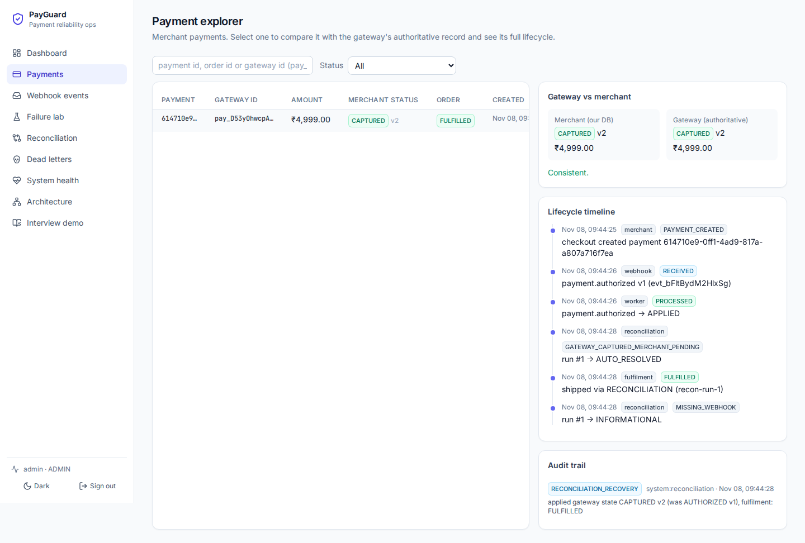
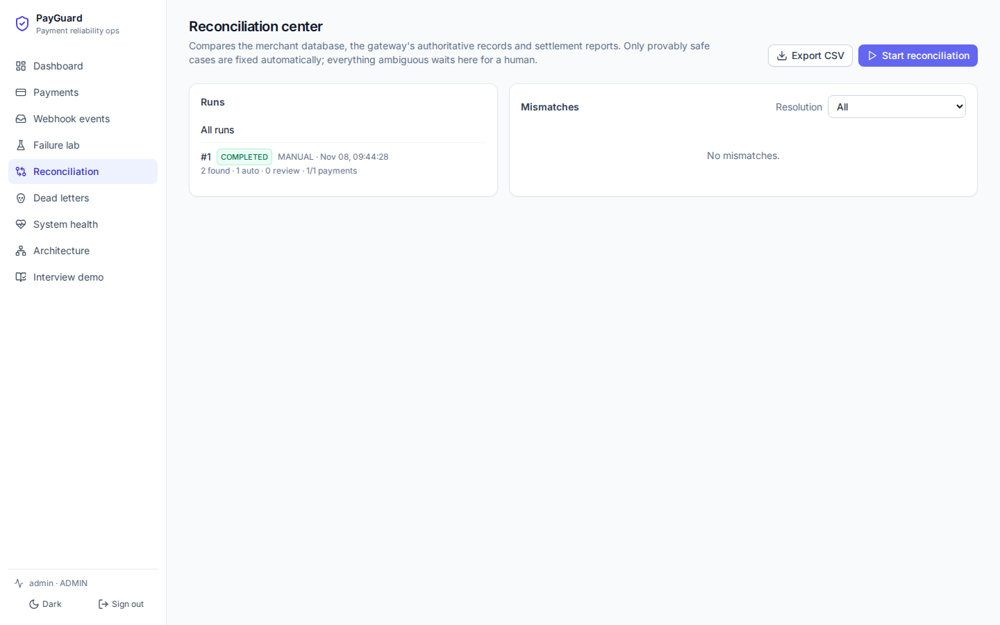
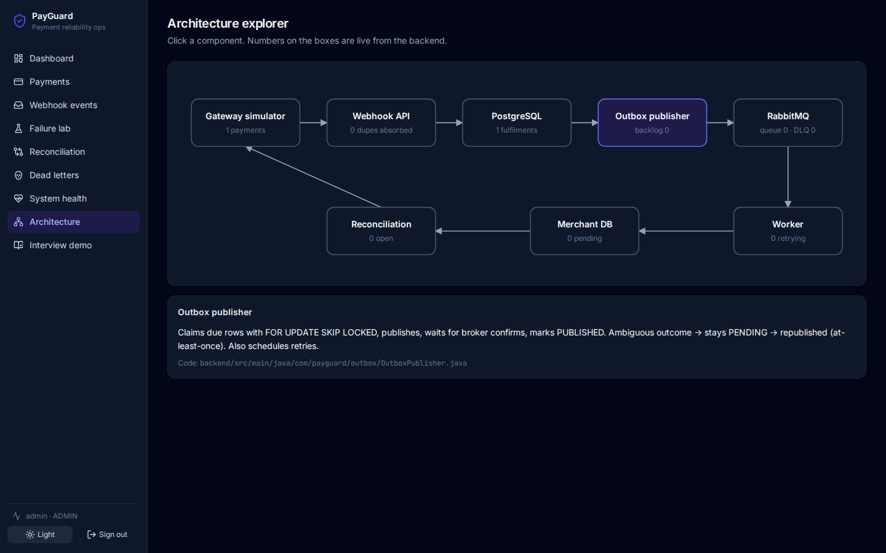
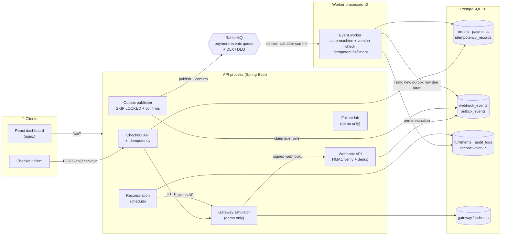
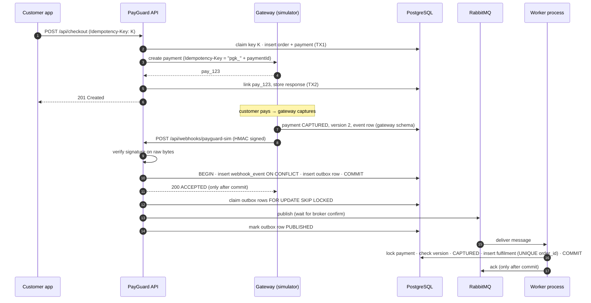
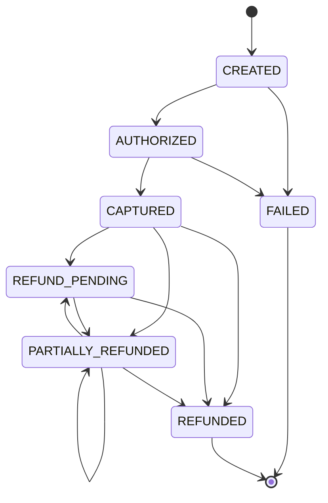

<div align="center">

# 🛡️ PayGuard

### Payment Reliability, Recovery & Reconciliation Platform

**A merchant payment backend that stays correct when webhooks are duplicated, delayed, out of order, forged or lost,
and when the server, the database or the message broker fails in the middle of a request.**

[](https://github.com/sandeepraj25/payment-reliability-recovery-platform/actions/workflows/ci.yml)


[The problem](#-the-problem) ·
[Screenshots](#-screenshots) ·
[Architecture](#-architecture) ·
[Tech stack](#-tech-stack) ·
[Getting started](#-getting-started) ·
[Tests & results](#-tests-and-verified-results) ·
[Docs](#-documentation)

</div>

---

> **No real money, no card data.** The payment gateway is a built-in simulator. This is a learning and portfolio
> project for backend / fintech engineering roles. It is carefully designed and tested, **but not production-certified**
> (see [Known limitations](#-known-limitations)).

## 📖 Table of contents
1. [The problem](#-the-problem)
2. [What PayGuard does](#-what-payguard-does)
3. [Features & functions (complete list)](#-features--functions)
4. [Screenshots](#-screenshots)
5. [Architecture](#-architecture)
6. [How one payment flows](#-how-one-payment-flows)
7. [Payment state machine](#-payment-state-machine)
8. [Reliability mechanisms](#-reliability-mechanisms)
9. [The 12 failure scenarios](#-the-12-failure-scenarios)
10. [Tech stack](#-tech-stack)
11. [Project structure](#-project-structure)
12. [Database](#-database)
13. [API reference](#-api-reference)
14. [Getting started](#-getting-started)
15. [Running the tests](#-running-the-tests)
16. [Tests and verified results](#-tests-and-verified-results)
17. [Security](#-security)
18. [Known limitations](#-known-limitations)
19. [Documentation](#-documentation)

---

## ❓ The problem

1. A customer buys a product for **₹4,999**.
2. The payment gateway (think Razorpay or Stripe) **captures** the money.
3. The gateway sends a **webhook** to the merchant: *"payment `pay_123` is CAPTURED"*.
4. At that exact moment the merchant server **crashes**, or its database is down.
5. The merchant database still says **PENDING**.
6. 💸 The customer has paid, but the order is **never shipped**.

Real systems face more than this one failure. Webhooks arrive **twice** (the gateway retries), arrive **late**,
arrive **out of order** (an old "authorized" after a newer "captured"), can be **forged** by anyone who finds the URL,
or are **never sent** at all.

**PayGuard prevents, detects, explains and recovers from all of these, and lets you inject each failure for real
and watch the recovery happen.**

> 🧠 **Analogy.** The gateway is a bank posting you letters ("your customer paid"). The post office sometimes delivers
> a letter twice, late, out of order, or not at all, and anyone can drop a fake letter in your box. PayGuard is the
> careful clerk who checks the seal on every letter, files it in a fire-proof cabinet *before* signing the receipt,
> never files the same letter twice, never ships an order twice, and phones the bank every few minutes to compare notes.

---

## ✨ What PayGuard does

| Module | What it does |
|--------|--------------|
| 🏦 **Gateway simulator** | Create / authorize / capture / fail / refund payments with an explicit state machine and row locks. Idempotent create and refund. Every change emits a versioned event and an **HMAC-signed webhook**. Manual redelivery, status API, settlement reports. |
| 🔐 **Secure webhook ingestion** | `POST /api/webhooks/{provider}`: HMAC-SHA256 over the **raw bytes**, constant-time compare, signed-timestamp replay window, secret rotation, strict schema validation. Event **and** outbox row are committed together **before** answering 200. |
| 🔁 **Idempotency (3 layers)** | API request keys (fingerprint, lease, fencing token, recovery points) · webhook dedup by `UNIQUE(provider, event_id)` · fulfilment dedup by `UNIQUE(order_id)`. |
| 📤 **Transactional outbox** | Publisher claims rows with `FOR UPDATE SKIP LOCKED`, publishes with **RabbitMQ publisher confirms**; ambiguous outcomes are safely republished. |
| ⚙️ **Reliable worker** | Separate process. Validates state transitions and event versions (stale events can't move a payment backwards), fulfils the order idempotently, **acks only after commit**. |
| ♻️ **Retries & dead letters** | Transient vs permanent failure classification, exponential backoff **with jitter**, attempt cap, dead-letter queue, **audited manual replay**. |
| 🧾 **Reconciliation** | Compares merchant DB vs gateway status API vs settlement reports. Auto-fixes only provably safe cases; everything ambiguous waits for a human, with evidence. CSV export. |
| 💥 **Failure Simulation Lab** | 12 scenarios injected into the **real backend** (crashes, outages, lost webhooks…), each recorded step by step with database evidence and invariant checks. |
| 📊 **Observability** | JSON logs with correlation ids, Micrometer / Prometheus metrics, health endpoints. |
| 🖥️ **Operations dashboard** | React + TypeScript: dashboard, payments, webhooks, failure lab, reconciliation, dead letters, system health, architecture explorer, interview demo mode. Light and dark theme. |

---

## 🧩 Features & functions

### Feature checklist

**Gateway simulator** (`gateway/`)
- ✅ Create payment (idempotent per `Idempotency-Key`; same key + different body → `422`)
- ✅ Authorize · capture · fail, through the explicit state machine (illegal moves → `409`, repeats → no-op)
- ✅ Partial and full refunds (idempotent per key; can never exceed the captured amount)
- ✅ One versioned event per state change; HMAC-signed webhook sent **after** commit
- ✅ Manual redelivery of any event (produces duplicate deliveries on demand) + delivery log
- ✅ Authoritative status API with keyset pagination (used by reconciliation)
- ✅ Settlement batches with a 2 % fee in integer arithmetic (captured ≠ settled)

**Webhook ingestion** (`webhook/`)
- ✅ Raw-byte HMAC-SHA256 verification, constant-time comparison
- ✅ Signed-timestamp replay window (±5 min) and multiple secrets for rotation
- ✅ Provider adapter interface (`WebhookVerifier`) so a real provider can be added without touching the pipeline
- ✅ Strict schema validation (integer money, ISO timestamps, id patterns, strict UTF-8, 64 KiB limit)
- ✅ Unknown event types stored as `IGNORED` (gateways add new types; they must not be retried forever)
- ✅ Event + outbox row in **one transaction**, committed before `200`
- ✅ Duplicate detection with a counter (`duplicate_count`), rejection log kept separately

**Idempotency** (`idempotency/`, `merchant/`)
- ✅ API request idempotency: fingerprint, lease, fencing token, recovery points, stored response replay, TTL cleanup
- ✅ Webhook event deduplication by `UNIQUE(provider, provider_event_id)`
- ✅ Idempotent fulfilment by `UNIQUE(order_id)` (also catches a second, different "paid" event)
- ✅ Deterministic downstream gateway key, so a resumed checkout never creates a second gateway payment

**Processing pipeline** (`outbox/`, `worker/`, `messaging/`)
- ✅ Outbox publisher: `FOR UPDATE SKIP LOCKED` claiming, publisher confirms, ambiguous outcome → republish
- ✅ Durable queue `payguard.payment-events`, dead-letter exchange `payguard.dlx`, DLQ `payguard.payment-events.dlq`
- ✅ Worker in a separate process, manual ack **after** DB commit, concurrency 2–4 consumers per process
- ✅ Version check (stale events skipped) + reachability (CREATED → CAPTURED allowed when intermediate events are late)
- ✅ Amount / currency mismatch and impossible transitions → permanent failure, dead-lettered, never "fixed" silently
- ✅ Retry with exponential backoff + jitter (base 1 s, max 1 min, 5 attempts) as delayed outbox rows
- ✅ Every attempt recorded in `processing_attempts` (retry history, error code, worker id, duration)
- ✅ Dead-letter list + manual replay (reason required, audited)

**Reconciliation** (`reconciliation/`)
- ✅ Scheduled (default every 5 min) or manual runs
- ✅ Compares merchant DB ↔ gateway status API ↔ settlement reports (15 mismatch types, table below)
- ✅ Auto-recovery only for provably safe cases, through the **same guarded code path** the worker uses
- ✅ Manual review with evidence; manual resolution with a note (audited)
- ✅ CSV report export (with spreadsheet-formula injection protection)

**Failure injection & simulation** (`faults/`, `simulation/`; exist only when `PAYGUARD_FAULTS_ENABLED=true`)
- ✅ 10 fault points armed in the database, so the API process can arm a fault the worker process consumes
- ✅ 12 end-to-end scenarios, each recording initial state → injected failure → observed state → recovery → final state
- ✅ Invariants verified against the database at the end of every run (e.g. "exactly one fulfilment")

**Operations, security & observability** (`ops/`, `audit/`, `config/`)
- ✅ Dashboard summary, per-minute time series, system health (DB, RabbitMQ, worker, outbox, queue depths)
- ✅ Payment lifecycle timeline that merges merchant, webhook, worker, reconciliation, fulfilment and audit events
- ✅ Append-only audit log (DB trigger blocks UPDATE/DELETE)
- ✅ Roles ADMIN / VIEWER / GATEWAY_CLIENT, BCrypt-hashed credentials from environment variables only
- ✅ Per-IP token-bucket rate limiting, strict CORS, security headers, structured error responses
- ✅ Correlation id per request (validated, propagated to logs and messages), JSON logs, Prometheus metrics

**Dashboard** (`frontend/`)
- ✅ 9 pages: Dashboard · Payments · Webhook events · Failure lab · Reconciliation · Dead letters · System health · Architecture · Interview demo
- ✅ Live data from the backend (polling via TanStack Query), charts (Recharts), light / dark theme, accessible controls (ARIA labels, visible focus)

### Key classes and functions

<details>
<summary><b>Gateway simulator</b></summary>

| Class | Function | What it does |
|-------|----------|--------------|
| `GatewayPaymentService` | `create(idempotencyKey, merchantOrderRef, amountMinor, currency)` | Creates a payment once per key; a repeat returns the same payment |
| | `authorize(id)` · `capture(id)` · `fail(id, reason)` | Locks the row (`FOR UPDATE`), asks the state machine, bumps the version, writes one event |
| | `refund(id, idempotencyKey, amountMinor)` | Idempotent partial / full refund; rejects amounts above what's left |
| `GatewayWebhookSender` | `onEventCreated(event)` | Runs **after commit**; sends the signed webhook asynchronously |
| | `deliver(eventId, triggerType)` | Sends (or re-sends) one event and logs the delivery |
| `GatewaySettlementService` | `run(cutoff)` · `batchesSince(since)` · `feeFor(gross)` | Builds settlement batches with integer fee arithmetic |
</details>

<details>
<summary><b>Webhook ingestion</b></summary>

| Class | Function | What it does |
|-------|----------|--------------|
| `WebhookController` | `receive(provider, headers, byte[] body)` | Takes the **exact** bytes so the HMAC is computed over what was signed |
| `WebhookIngestionService` | `ingest(provider, headers, rawBody, sourceIp)` | Size check → signature → schema → one TX (event + outbox) → `ACCEPTED` / `DUPLICATE` / `IGNORED` |
| `WebhookSignature` | `sign(t, body, secret)` · `verify(header, body, secrets, now, tolerance)` | `t=…,v1=…` header, HMAC over `"t.body"`, constant-time compare, timestamp tolerance |
| `PayGuardSimVerifier` | `verify(headers, body)` | Provider adapter for the simulator (implements `WebhookVerifier`) |
| `WebhookPayloadParser` | `parse(rawBody)` | Strict validation into a typed `ParsedEvent` |
| `WebhookEventStore` | `insertOrMarkDuplicate(...)` | `INSERT … ON CONFLICT DO NOTHING`, else increment `duplicate_count` |
| | `insertRejection(...)` · `recentEvents(...)` · `findEvent(id)` | Rejection log and explorer queries |
</details>

<details>
<summary><b>Idempotency and checkout</b></summary>

| Class | Function | What it does |
|-------|----------|--------------|
| `IdempotencyService` | `claim(scope, key, fingerprint)` | Returns `Acquired`, `Replay`, `InFlight` or `FingerprintMismatch` (sealed interface) |
| | `advance(claim, recoveryPoint, resourceId)` | Saves progress inside the caller's transaction (fencing-token checked) |
| | `complete(claim, status, body)` · `release(claim)` | Stores the final response / frees the key after a failure |
| | `deleteExpired()` | Scheduled TTL cleanup in batches |
| `CheckoutService` | `checkout(key, command)` | TX1 order + payment → gateway HTTP call (no TX open) → TX2 link + store response |
| | `gatewayKeyFor(paymentId)` | Deterministic `pgk_<paymentId>`: the reason a retried checkout can't double-charge |
| `GatewayClient` | `createPayment(...)` · `getPayment(id)` · `listPaymentsUpdatedSince(t)` · `settlementReportsSince(t)` | Merchant's HTTP client for the gateway; timeouts become `503` |
</details>

<details>
<summary><b>Outbox, worker, retries and dead letters</b></summary>

| Class | Function | What it does |
|-------|----------|--------------|
| `OutboxStore` | `insert(...)` | Adds a "publish me" row (purpose `INGEST`, `RETRY`, `REPLAY` or `RECOVERY`) |
| | `claimDue(limit, now)` | `SELECT … FOR UPDATE SKIP LOCKED`: several publishers never take the same row |
| | `markPublished(ids, now)` · `markPublishFailed(ids, error, now)` | Records the broker outcome |
| `OutboxPublisher` | `poll()` (every 500 ms) · `publishOnce()` | Claims, publishes, waits for publisher confirms |
| `PaymentEventListener` | `onMessage(message, channel)` | RabbitMQ consumer with **manual ack after commit** |
| `EventProcessor` | `process(webhookEventId, workerId, redelivered, …)` | Locks event + payment, applies the gateway state, records the attempt |
| `GatewayStateApplier` | `apply(payment, gatewayState, source, ref, now)` | One guarded path for worker **and** reconciliation: `APPLIED`, `NO_CHANGE`, `STALE`, `AMOUNT_MISMATCH`, `UNREACHABLE` |
| `FulfilmentService` | `fulfilIfFirst(order, payment, source, ref, now)` | Ships once (`UNIQUE(order_id)`); detects a suspected double charge |
| `FailureClassifier` | `classify(error)` · `code(error)` | `TRANSIENT` vs `PERMANENT`, with a stable error code |
| `RetryPolicy` | `shouldRetry(attempts)` · `delayAfter(attempt, random)` | Exponential backoff with jitter and a cap |
| `FailureHandler` | `handle(webhookEventId, error, …)` | `RETRY_SCHEDULED` (new delayed outbox row) or `DEAD_LETTERED` |
| `DeadLetterService` | `list(limit)` · `replay(id, actor, reason)` · `brokerDlqDepth()` | Inspect and safely replay dead events (audited) |
</details>

<details>
<summary><b>Reconciliation</b></summary>

| Class | Function | What it does |
|-------|----------|--------------|
| `ReconciliationRules` | `compare(merchant, gateway, settlements, …)` | Pure function: three data sets in, list of `Finding`s out (unit-tested in isolation) |
| `ReconciliationService` | `run(triggerType, actor)` | Loads data, compares, stores the run and mismatches, auto-recovers only allow-listed types |
| | `resolveManually(mismatchId, actor, note)` | Human decision, written to the audit log |
| `ReconciliationController` | `report.csv` endpoint | CSV export with formula-injection protection |
</details>

<details>
<summary><b>Domain, failure lab and cross-cutting</b></summary>

| Class | Function | What it does |
|-------|----------|--------------|
| `PaymentStateMachine` | `decide(from, to)` · `assertAllowed(from, to)` · `isReachable(from, to)` · `allowedFrom(from)` | Single source of truth for legal payment transitions |
| `FaultInjector` | `arm(point, times, actor)` · `shouldFire(point)` · `crashIfArmed(point)` · `disarmAll()` | DB-backed fault switches shared by API and worker processes |
| `SimulationRunner` | `start(scenario, actor)` | Runs one of the 12 scenarios and records the timeline + invariants |
| `AuditLog` | `record(actor, action, target, reason, …)` · `recent(...)` | Append-only audit trail |
| `RateLimitFilter` | per-request filter | Token bucket per client IP and route class; `429` + `Retry-After` |
| `CorrelationIdFilter` | per-request filter | Accepts or creates a correlation id and puts it into every log line |
</details>

### What reconciliation detects

| Mismatch type | Severity | Handling |
|---------------|----------|----------|
| `GATEWAY_CAPTURED_MERCHANT_PENDING` | critical | **auto-recover** |
| `STATE_LAG` | warning | **auto-recover** |
| `MERCHANT_CAPTURED_GATEWAY_NOT_CAPTURED` | critical | manual review |
| `MERCHANT_AHEAD_OF_GATEWAY` | critical | manual review |
| `UNEXPECTED_STATE` | critical | manual review |
| `AMOUNT_MISMATCH` | critical | manual review |
| `GATEWAY_PAYMENT_NOT_FOUND` | critical | manual review |
| `DOUBLE_CHARGE` | critical | manual review |
| `MISSING_SETTLEMENT` | critical | manual review |
| `SETTLEMENT_AMOUNT_MISMATCH` | critical | manual review |
| `ORPHAN_GATEWAY_PAYMENT` | warning | manual review |
| `DEAD_LETTERED_EVENT` | warning | manual review |
| `MISSING_WEBHOOK` | warning | informational |
| `DELAYED_SETTLEMENT` | warning | informational |
| `DUPLICATE_DELIVERIES` | info | informational |

Only two types are ever fixed automatically, and both are fixed by applying the gateway's own (newer) state through
`GatewayStateApplier`. Anything involving money disagreement or a merchant claim the gateway can't confirm waits for a human.

### Fault points (failure lab)
`WORKER_CRASH_BEFORE_COMMIT` · `WORKER_CRASH_AFTER_COMMIT` · `WORKER_TRANSIENT_ERROR` · `OUTBOX_CRASH_AFTER_CONFIRM` ·
`OUTBOX_BROKER_UNAVAILABLE` · `GATEWAY_DROP_WEBHOOK` · `GATEWAY_DELAY_WEBHOOK` · `GATEWAY_SETTLEMENT_OMIT` ·
`GATEWAY_API_TIMEOUT` · `INGESTION_DB_UNAVAILABLE`

---

## 📸 Screenshots

All screenshots were captured automatically by the Playwright end-to-end tests in CI, against the **real** running
system (API process + worker process + PostgreSQL + RabbitMQ). Nothing is mocked.

### Dashboard
Live numbers from PostgreSQL and RabbitMQ: payments, recoveries, outbox backlog, retry queue, open mismatches.


### Failure Simulation Lab: "Missing webhook"
The gateway captures ₹4,999 but **never sends the webhook**. The timeline shows the initial state, the injected failure,
the broken state (*customer paid, merchant still PAYMENT_PENDING*), reconciliation recovering it, and the final state.
Every block is queried from the database. At the bottom, the invariants are checked: *exactly one fulfilment, merchant
matches gateway, order fulfilled.*

<p align="center"></p>

### Payment explorer
Merchant record vs the gateway's authoritative record side by side, the full lifecycle timeline, and the audit trail.


### Reconciliation center
Runs, findings, auto-resolved vs manual-review cases, CSV export.


### Architecture explorer (dark mode)
Click any component for a short technical explanation and a link to its source file. Numbers on the boxes are live.


---

## 🏗️ Architecture

PayGuard is a **modular monolith**: one Spring Boot codebase, one PostgreSQL database, deployed as **separate
processes** (an API process and worker processes). It is not split into microservices, because every reliability problem
worth demonstrating already exists at the real network boundaries (merchant ↔ gateway over HTTP, API ↔ worker over
RabbitMQ), and microservices would add operational cost without teaching anything new.



**Deployment (Docker Compose):**

| Container | Role | Key settings |
|-----------|------|--------------|
| `backend` | HTTP API, webhook ingestion, outbox publisher, gateway simulator, reconciliation scheduler, failure lab | `PAYGUARD_WORKER_ENABLED=false` |
| `worker` ×2 | RabbitMQ consumers only, no web server; two processes compete on one queue | `SPRING_MAIN_WEB_APPLICATION_TYPE=none` |
| `frontend` | nginx serving the dashboard and proxying `/api` (same origin, so no CORS needed) | port 5173 |
| `postgres`, `rabbitmq` | State and messaging, durable volumes | ports bound to `127.0.0.1` |

The **same jar** runs in both roles, switched by environment flags. CI starts exactly this split topology for its e2e and
load tests.

---

## 🔄 How one payment flows



**What if something breaks?**
* Crash before step 13's COMMIT → no 200 → the gateway retries → stored next time.
* Duplicate webhook → `ON CONFLICT` → `200 DUPLICATE`, no second outbox row.
* RabbitMQ down → outbox rows stay `PENDING` → published when it is back.
* Worker crashes after commit, before ack → message redelivered → already `PROCESSED` → skipped; fulfilment is unique per order anyway.
* Webhook never arrives → reconciliation asks the gateway's status API → recovers through the same guarded code path.

---

## 🚦 Payment state machine



* Every transition is decided as **APPLY**, **NO_OP** (same state again, which is what makes retries harmless) or **REJECT**.
  All 7 × 7 = 49 pairs are covered by `PaymentStateMachineTest`.
* Each gateway change bumps a **version**. An event with a version ≤ the stored one is **stale** and skipped, so a late
  "authorized" can never undo "captured".
* **Settlement is not a payment state.** *Captured* = customer charged; *settled* = money reached the merchant's bank,
  later and in batches. It lives in its own table.

---

## 🧱 Reliability mechanisms

| Problem | Mechanism | Where |
|---------|-----------|-------|
| Forged webhooks | HMAC-SHA256 over raw bytes, `MessageDigest.isEqual` (constant time), signed timestamp ±5 min | `webhook/signature/WebhookSignature.java` |
| Forged event "squatting" a real event id | Rejected requests go to `webhook_rejections`, never to `webhook_events` | `WebhookIngestionService` |
| Acknowledging before storing | 200 is returned only after the DB transaction commits | `WebhookIngestionService` |
| Duplicate webhook | `UNIQUE(provider, provider_event_id)` + `INSERT … ON CONFLICT DO NOTHING` | `WebhookEventStore` |
| Client retries a checkout | Idempotency key + request fingerprint + lease + fencing token + recovery points | `idempotency/IdempotencyService` |
| Crash after the gateway call | Deterministic downstream key `pgk_<paymentId>`: the retry gets the same gateway payment | `CheckoutService.gatewayKeyFor` |
| DB commit ≠ message sent | Transactional outbox, publisher confirms, at-least-once + idempotent consumer | `outbox/` |
| Two publishers / workers racing | `FOR UPDATE SKIP LOCKED`, row locks, `@Version` | `OutboxStore`, `EventProcessor` |
| Stale / out-of-order events | Version comparison + reachability rules | `worker/EventProcessor`, `merchant/GatewayStateApplier` |
| Shipping twice | `UNIQUE(order_id)` on `fulfilments` | `merchant/FulfilmentService` |
| Transient errors | Exponential backoff with jitter (base 1 s, max 1 min, 5 attempts), scheduled as delayed outbox rows | `worker/RetryPolicy`, `FailureHandler` |
| Permanent errors | Classified, dead-lettered (DB status `DEAD` + RabbitMQ DLQ), audited manual replay | `worker/FailureClassifier`, `DeadLetterService` |
| Missing webhook | Reconciliation vs gateway status API, safe auto-fix allow-list, manual review otherwise | `reconciliation/` |
| History rewriting | `audit_logs` append-only, enforced by a database trigger | migration V6 |

**Exactly-once is not a network guarantee.** Delivery is *at-least-once*; PayGuard turns that into an *exactly-once
effect* through idempotent processing at three layers: request, event and fulfilment.

---

## 💥 The 12 failure scenarios

Each one is injected into the **real** backend from the Failure Simulation Lab, and each has a focused integration test.

| # | Scenario | What protects us |
|---|----------|------------------|
| 1 | Duplicate webhook delivery | DB unique constraint, `200 DUPLICATE`, no second outbox row |
| 2 | Delayed webhook | Order waits in `PAYMENT_PENDING` (no guessing), processed when it arrives |
| 3 | Out-of-order events | Version check: the stale event is `SKIPPED_STALE` |
| 4 | Worker crash before DB commit | Transaction rolls back; unacked message is redelivered |
| 5 | Worker crash after commit, before ack | Redelivery finds it `PROCESSED`; `UNIQUE(order_id)` |
| 6 | Database unavailable | No commit → `503` → gateway retries; never a false 2xx |
| 7 | RabbitMQ unavailable | Outbox rows stay `PENDING` with backoff; webhooks still accepted |
| 8 | Outbox publisher crash | Rows return to `PENDING`, are republished, consumer dedups |
| 9 | Missing webhook | Reconciliation detects `GATEWAY_CAPTURED_MERCHANT_PENDING`, guarded auto-recovery |
| 10 | Concurrent duplicate requests | Idempotency key claim + lease: one order, one gateway payment |
| 11 | Gateway API timeout | `503` to client; retry with the same key reuses the same gateway payment |
| 12 | Invalid webhook signature | `401`, stored only in `webhook_rejections`, state untouched |

Details: [`docs/failure-scenarios.md`](docs/failure-scenarios.md).

---

## 🧰 Tech stack

| Layer | Technology | Version | Why it was chosen |
|-------|------------|---------|-------------------|
| Language | Java | 21 | Records, sealed interfaces and pattern-matching `switch` make states and outcomes explicit |
| Framework | Spring Boot (Web, Data JPA, Security, Validation, Actuator, AMQP) | 3.5.16 | Industry standard for Java backends; transactions and DI out of the box |
| Database | PostgreSQL | 16 | ACID transactions, `ON CONFLICT`, `FOR UPDATE SKIP LOCKED`, JSONB |
| Migrations | Flyway | (Boot-managed) | Versioned, reviewable schema; Hibernate only *validates* |
| Data access | Spring Data JPA + `JdbcClient` | — | JPA for simple aggregates; explicit SQL wherever concurrency semantics matter |
| Messaging | RabbitMQ + Spring AMQP | 3.13 | Durable queues, manual acks, publisher confirms, dead-letter exchange |
| Metrics | Micrometer + Prometheus registry | (Boot-managed) | Standard metrics endpoint |
| Frontend | React · TypeScript · Vite | 18.3 · 5.6 · 5.4 | Typed, fast dev server and build |
| UI | Tailwind CSS · Recharts · Lucide icons | 3.4 · 2.13 · 0.454 | Clean dashboard, charts, consistent icons |
| Data fetching | TanStack Query · React Router | 5.59 · 6.28 | Caching and polling of live backend data |
| Unit / integration tests | JUnit 5 · Mockito · Spring Boot Test · REST Assured · Awaitility | (Boot-managed) | Real HTTP and real async assertions |
| Containers in tests | Testcontainers (PostgreSQL, RabbitMQ) | (Boot-managed) | Real databases in tests; no H2 fakes |
| E2E tests | Playwright | 1.63 | Drives the real dashboard against the real stack |
| Load test | Node.js script, zero dependencies | Node 22 | Checks correctness under load and records latency |
| Packaging | Docker · Docker Compose · nginx | — | One command to run everything |
| CI | GitHub Actions | — | 5 jobs on every push |

**Deliberately not used:** Kafka, Kubernetes, microservices, AI features, and Redis as a source of truth. Each would add
complexity without making the payment logic more correct. Redis would be justified only for a global rate limiter,
never for financial state or idempotency.

---

## 📁 Project structure

```
payment-reliability-recovery-platform/
├── backend/                          Spring Boot 3.5 · Java 21 · Maven
│   ├── src/main/java/com/payguard/
│   │   ├── gateway/                  Gateway simulator (own DB schema "gateway")
│   │   ├── webhook/                  Ingestion, payload parser, event store
│   │   │   ├── signature/            HMAC header format
│   │   │   └── verification/         Provider adapters (WebhookVerifier)
│   │   ├── idempotency/              API request idempotency (leases, fencing)
│   │   ├── merchant/                 Orders, payments, fulfilment, checkout API
│   │   ├── outbox/                   Transactional outbox + publisher
│   │   ├── messaging/                RabbitMQ topology (queue, DLX, DLQ)
│   │   ├── worker/                   Consumer, retry policy, failure classifier, DLQ replay
│   │   ├── reconciliation/           Rules, runs, mismatches, CSV export
│   │   ├── simulation/ + faults/     Failure Simulation Lab (demo only)
│   │   ├── domain/payment/           PaymentStatus + PaymentStateMachine
│   │   ├── audit/ · ops/ · config/   Audit log, dashboard API, security, rate limiting
│   │   └── common/                   Crypto, errors, ids
│   ├── src/main/resources/db/migration/   Flyway V1 … V8
│   └── src/test/
│       ├── java/…                    *Test = unit, *IT = integration
│       └── sql/                      Schema checks + pgbench concurrency script
├── frontend/                         React + TypeScript + Vite + Tailwind
│   ├── src/pages/                    9 pages (+ login)
│   └── e2e/                          Playwright tests
├── loadtest/run.mjs                  Load test against the real stack
├── docs/                             Design docs, ADRs, interview guide, results, screenshots
├── docker-compose.yml
└── .github/workflows/ci.yml          backend · schema · frontend · e2e · load
```

---

## 🗄️ Database

PostgreSQL 16, schema owned by Flyway (8 migrations). Money is always `BIGINT` in minor units (paise); fractions are
rejected, never rounded.

| Table | Purpose | Key guarantee |
|-------|---------|---------------|
| `orders`, `payments` | Merchant's view (may lag the gateway, by design) | `UNIQUE(provider, gateway_payment_id)` |
| `idempotency_records` | API request idempotency | `UNIQUE(scope, idempotency_key)` |
| `webhook_events` | Every authentic webhook | `UNIQUE(provider, provider_event_id)` |
| `webhook_rejections` | Failed verifications (kept apart on purpose) | Never occupies a real event id |
| `outbox_events` | "Please publish this" rows, incl. delayed retries | Written in the same TX as the event |
| `processing_attempts` | Retry history per event | `UNIQUE(webhook_event_id, attempt_no)` |
| `fulfilments` | Order shipped | `UNIQUE(order_id)`: never twice |
| `reconciliation_runs`, `reconciliation_mismatches` | Findings with evidence and resolution | One row per run + type + payment/order/event identity |
| `settlement_batches`, `settlement_records` | Settlement reports as received by the merchant | `UNIQUE(batch_id, gateway_payment_id)`; captured ≠ settled |
| `audit_logs` | Who changed what and why | Append-only, enforced by a trigger |
| `fault_injections`, `simulation_runs` | Failure lab (demo only) | Armed faults shared across processes; JSONB run timelines |
| `gateway.*` | Simulator: payments, refunds (`UNIQUE(payment_id, idempotency_key)`), events (`UNIQUE(payment_id, payment_version)`), deliveries, settlements | Separate schema; merchant code reads it only via HTTP |

Full design (keys, indexes, transaction boundaries, retention): [`docs/database-design.md`](docs/database-design.md).

---

## 🔌 API reference

Every endpoint in the backend. Auth: HTTP Basic (except webhooks, which are authenticated by HMAC).
`GET /api/**` is open to ADMIN and VIEWER; every other `/api/**` call needs ADMIN.

**Merchant**

| Method | Path | Purpose |
|--------|------|---------|
| POST | `/api/checkout` | Create order + payment; header `Idempotency-Key` required |
| GET | `/api/orders/{orderId}` | Order with all payment attempts |
| GET | `/api/payments` | Payment explorer list (search / status filter) |
| GET | `/api/payments/{paymentId}/timeline` | Merged lifecycle timeline, gateway vs merchant, audit trail |
| GET | `/api/me` | Current user and role |

**Webhooks**

| Method | Path | Purpose |
|--------|------|---------|
| POST | `/api/webhooks/{provider}` | Ingest a signed webhook (`PayGuard-Signature: t=…,v1=…`) |
| GET | `/api/webhook-events` | Event explorer |
| GET | `/api/webhook-events/{id}` | One event incl. exact signed payload and hash |
| GET | `/api/webhook-events/{id}/attempts` | Processing attempts (retry history) |
| GET | `/api/webhook-events/{id}/outbox` | Outbox rows for the event |
| GET | `/api/webhook-rejections` | Rejected requests (bad signature / payload) |

**Dead letters, reconciliation, operations**

| Method | Path | Purpose |
|--------|------|---------|
| GET | `/api/dead-letters` | Dead-lettered events with failure reasons |
| POST | `/api/dead-letters/{webhookEventId}/replay` | Safe, audited replay (reason required) |
| POST | `/api/reconciliation/runs` | Start a reconciliation run |
| GET | `/api/reconciliation/runs` · `/api/reconciliation/runs/{id}` | Runs and their results |
| GET | `/api/reconciliation/runs/{id}/report.csv` | CSV export |
| GET | `/api/reconciliation/mismatches` | Findings (filter by resolution) |
| POST | `/api/reconciliation/mismatches/{id}/resolve` | Manual resolution with a note |
| GET | `/api/ops/summary` · `/api/ops/timeseries` · `/api/ops/health` | Dashboard numbers, charts, system health |
| GET | `/api/audit` | Audit log |
| GET | `/actuator/health` · `/actuator/prometheus` | Health (public) · metrics (ADMIN) |

**Failure lab** (exists only when `PAYGUARD_FAULTS_ENABLED=true`)

| Method | Path | Purpose |
|--------|------|---------|
| GET | `/api/simulations/scenarios` | The 12 scenarios |
| POST | `/api/simulations/{scenario}/runs` | Run a scenario on the real backend |
| GET | `/api/simulations/runs` · `/api/simulations/runs/{id}` | Recorded timelines and invariants |
| GET · POST · DELETE | `/api/faults` · `/api/faults/{point}` · `/api/faults` | List / arm / disarm fault points |

**Gateway simulator** (`/sim/gateway`, roles GATEWAY_CLIENT or ADMIN, demo only)

| Method | Path | Purpose |
|--------|------|---------|
| POST | `/payments` | Create payment (`Idempotency-Key`) |
| GET | `/payments` · `/payments/{id}` | Status API (keyset-paginated list) · one payment |
| POST | `/payments/{id}/authorize` · `/capture` · `/fail` | State transitions |
| POST · GET | `/payments/{id}/refunds` | Refund (`Idempotency-Key`) · list refunds |
| GET | `/payments/{id}/events` | Events emitted for a payment |
| POST | `/events/{eventId}/redeliver` | Re-send a webhook (duplicate on demand) |
| GET | `/events/{eventId}/deliveries` | Delivery attempts |
| POST · GET | `/settlements/run` · `/settlements` | Create a settlement batch · list reports |

All errors share one shape: `{ "code": "IDEMPOTENCY_KEY_REUSED", "message": "...", "details": [], "timestamp": "..." }`.
Full reference with curl examples: [`docs/api-documentation.md`](docs/api-documentation.md).

---

## 🚀 Getting started

### Prerequisites
* **Docker Desktop** (that's enough to run the app)
* For development and tests: **Java 21**, **Maven 3.9**, **Node.js 22**

### Run everything
```bash
git clone https://github.com/sandeepraj25/payment-reliability-recovery-platform.git
cd payment-reliability-recovery-platform
cp .env.example .env        # Windows: copy .env.example .env
# edit .env: change every "change-me" value; passwords must be at least 12 characters
docker compose up --build
```

| Open | URL |
|------|-----|
| Dashboard | http://localhost:5173 (log in with `PAYGUARD_ADMIN_USER` / `PAYGUARD_ADMIN_PASSWORD`) |
| API health | http://localhost:8080/actuator/health |
| RabbitMQ management | http://localhost:15672 |

### First demo (2 minutes)
1. Open **Failure lab** → choose **Missing webhook** → **Execute**.
2. Watch the five steps: the customer paid, the merchant is stuck, reconciliation recovers it, exactly one fulfilment.
3. Open **Payments**, select that payment, and compare the gateway vs merchant view and the lifecycle timeline.

Full guided tour and a 5-minute video script: [`docs/demo-walkthrough.md`](docs/demo-walkthrough.md).

Stop with `docker compose down` (add `-v` to also delete the data).

---

## 🧪 Running the tests

| Test | Command | Needs |
|------|---------|-------|
| Unit tests | `cd backend && mvn test` | Java 21 + Maven |
| Unit + integration tests | `cd backend && mvn verify` | Docker running (Testcontainers starts PostgreSQL and RabbitMQ) |
| Browser e2e | `cd frontend && npx playwright test` | App running via Docker Compose; `PAYGUARD_E2E_PASSWORD` set |
| Load test | `node loadtest/run.mjs` | App running; `PAYGUARD_RATE_LIMIT_ENABLED=false`; `ADMIN_PASSWORD`, `WEBHOOK_SECRET` set |

No Docker? Point the integration tests at your own PostgreSQL / RabbitMQ with `PAYGUARD_TEST_DB_URL`,
`PAYGUARD_TEST_DB_USER`, `PAYGUARD_TEST_DB_PASSWORD`, `PAYGUARD_TEST_RABBIT_HOST` (the 2 real-outage tests are then skipped).

---

## ✅ Tests and verified results

Every number here comes from a CI log; nothing is estimated. Full details, run ids and the history of failed runs are in
[`docs/testing-results.md`](docs/testing-results.md).

| Check | Result |
|-------|--------|
| Unit tests | **155 passed**, 0 failures |
| Integration tests (real PostgreSQL + RabbitMQ) | **80 passed**, 0 failures, including real `docker pause` outages of PostgreSQL and RabbitMQ |
| SQL schema invariant checks | all passed |
| 1,000 concurrent inserts of the same webhook (pgbench) | **1 row stored, 999 duplicates counted** |
| 1,000 simultaneous duplicate webhooks over HTTP (`WebhookConcurrencyIT`) | passed |
| Playwright e2e against API + separate worker process | **6 / 6 passed** |
| Load test | **13 / 13 correctness invariants passed** |

**Under load** (CI run 42467595295, everything on one 4-vCPU runner):
* A **retry storm** of 300 simultaneous requests sharing 50 idempotency keys created **exactly 50 orders**.
* **200 paid orders were shipped exactly once each**, despite 150 duplicate redeliveries of the capture webhook.
* Of 2,000 signed webhooks with 20 % repeats, **1,600 were stored once and all 400 repeats recognised as duplicates**.
* Webhook ingestion p50 ≈ 30 ms. Checkout p50 ≈ 0.8–1.0 s, dominated by per-request BCrypt password checks (analysis
  in the results doc). Numbers vary a lot between CI machines and are **not** benchmarks.

---

## 🔒 Security

* Webhooks authenticated by **HMAC over raw bytes**, constant-time compare, replay window, secret rotation.
* Roles: **ADMIN** (changes), **VIEWER** (read-only), **GATEWAY_CLIENT** (simulator API only); everything else denied.
* Secrets only from environment variables; the app **refuses to start** with missing or short passwords.
* Simulator and failure lab are **off by default** and do not exist (404) unless enabled.
* Input validation everywhere; money must be an integer; 64 KiB webhook body limit.
* Per-IP **rate limiting** (token bucket), strict **CORS** origin list, security headers, no stack traces in responses.
* **Append-only audit log** enforced by a database trigger; replays and manual resolutions require a reason.
* Secrets, signatures and payloads are never logged.

Full self-review: [`docs/security-review.md`](docs/security-review.md).

---

## ⚠️ Known limitations

* **Not production-certified.** Self-review only; no penetration test.
* HTTP Basic auth with BCrypt on every request: simple, but costly under load. Production would use OIDC / short-lived tokens.
* Rate limiting is per instance (in memory).
* No TLS in the local stack; one DB role for migrations and the app; no dependency scanning in CI yet.
* Load-test numbers come from shared CI machines and describe only those machines.

---

## 📚 Documentation

| Document | What's inside |
|----------|---------------|
| [System design](docs/system-design.md) | Architecture, flows, invariants, deployment |
| [Database design](docs/database-design.md) | Every table: purpose, keys, indexes, transactions, retention |
| [Architecture decisions](docs/architecture-decisions.md) | ADRs: what was chosen, what was rejected, and why |
| [Failure scenarios](docs/failure-scenarios.md) | The 12 scenarios, how each is injected, what protects us |
| [API documentation](docs/api-documentation.md) | Endpoints, error codes, curl walkthrough |
| [Testing results](docs/testing-results.md) | Only executed results, with CI run ids and history |
| [Security review](docs/security-review.md) | What is protected and what is knowingly left out |
| [Demo walkthrough](docs/demo-walkthrough.md) | Guided tour and 5-minute video script |
| [Interview guide](docs/interview-guide.md) | Per feature: problem, design, alternatives, crash behaviour, Q&A, bugs CI caught |
| [Learning roadmap](docs/learning-roadmap.md) | Prerequisites explained in plain language |
| [Project progress](PROJECT_PROGRESS.md) | What's done, what was verified, what's next |

---

<div align="center">

Built by **[@sandeepraj25](https://github.com/sandeepraj25)** as a backend engineering portfolio project.

</div>
